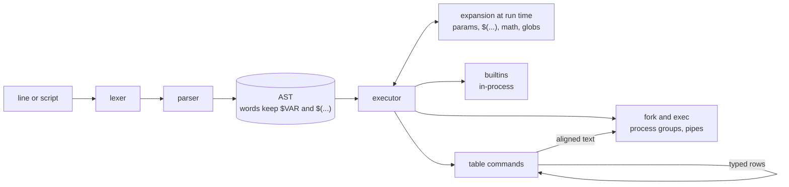

<div align="center">

<picture>
  <source media="(prefers-color-scheme: dark)" srcset=".github/assets/logo-dark.svg">
  
</picture>

### A Unix shell in Rust that speaks plain text and typed tables.<br>Scripts like bash, feels like fish, filters like nushell.

<p>
  <a href="https://github.com/gdprojectsss/goRustlyFast/actions/workflows/ci.yml"></a>
  <a href="https://www.rust-lang.org"></a>
  <a href="Cargo.toml"></a>
  <a href="LICENSE"></a>
  <a href="https://github.com/gdprojectsss/goRustlyFast/stargazers"></a>
  
</p>

<p>
  <a href="#quick-start"><b>Quick start</b></a> |
  <a href="#table-pipelines"><b>Table pipelines</b></a> |
  <a href="#why-grfsh"><b>Why grfsh</b></a> |
  <a href="#how-it-works"><b>How it works</b></a> |
  <a href="#roadmap"><b>Roadmap</b></a> |
  <a href="README.ro.md"><b>Romana</b></a>
</p>


</div>

<br>

> [!NOTE]
> grfsh is a young shell. It runs real scripts and makes a pleasant interactive shell, but it is not a complete POSIX `sh` yet (`case` and `trap` are still missing), so keep bash around for system scripts.

## What is grfsh?

grfsh is a single, small binary that tries to keep the parts of each shell people actually like:

- **The syntax you already know.** Pipes, redirections, `if`/`for`/`while`, functions, `$(...)`, `${x:-default}`, `$((math))`, heredocs and job control behave the way bash taught you.
- **The comfort of a modern shell.** Autosuggestions from history, syntax highlighting, completion that knows git branches and ssh hosts, "did you mean" for typos, a `z` command that remembers where you go, and a prompt that tells you when something failed or took a while.
- **Pipelines that understand data.** Commands like `files`, `procs` and `load` produce typed tables, so `where size -gt 10mb` compares sizes and `where modified gt 2d` compares dates. Pipe a table into `grep` or `wc` and it turns back into plain text.

All of it with two dependencies: `rustyline` for line editing and `libc` for processes and signals.

## Quick start

```sh
cargo install --git https://github.com/gdprojectsss/goRustlyFast
grfsh
```

Or build from a clone with `cargo build --release` and run `target/release/grfsh`.

```
grfsh                          interactive shell
grfsh script.sh [args...]      run a script
grfsh -c 'command' [name args] run one command line
```

A few things to try once it is running:

```sh
for f in src/*/mod.rs; do echo "$f: $(wc -l < $f) lines"; done
greet() { local who=${1:-world}; echo "hi $who"; }; greet
sleep 30 &                     # then: jobs, fg, Ctrl-Z, bg
gti status                     # did you mean 'git'?
z proj                         # jump to a directory you visit often
git checkout <TAB>             # branches
```

## Table pipelines

Table commands hand each other typed rows. On a terminal the result is an aligned table, anywhere else it is plain text that `grep`, `awk` and friends understand.

```console
$ load servers.csv | where cpu -gt 50 | sort-by cpu -r
host   region  cpu  uptime_days
-----  ------  ---  -----------
db-1   us       91          203
web-1  eu       72           41

$ load servers.csv | where region == eu | to json
[{"host":"web-1","region":"eu","cpu":72,"uptime_days":41},{"host":"web-2","region":"eu","cpu":18,"uptime_days":41}]

$ ps aux | where %CPU gt 5 | select PID %CPU COMMAND
```

| Command | What it does |
| --- | --- |
| `files [path] [-a]` | directory listing with name, type, size, modified |
| `procs` | running processes with pid, ppid, cpu, mem, rss, name |
| `load <file>` | reads `.csv`, `.tsv`, `.json`, `.jsonl`, anything else as lines |
| `from csv\|tsv\|json\|jsonl\|ws\|lines` | parses text coming from a pipe |
| `where <column> <op> <value>` | keeps matching rows, ops: `== != =~ !~ eq ne lt le gt ge` |
| `sort-by <column>... [-r]` | sorts by one or more columns |
| `select` / `reject <column>...` | keeps or drops columns |
| `first [n]`, `skip [n]`, `reverse` | slices rows |
| `count`, `get <column>` | prints the row count or one column as plain lines |
| `to csv\|tsv\|json\|md\|table` | converts the table to text |

<details>
<summary><b>Details: values, operators and text input</b></summary>

<br>

- Values follow the column type: `10mb` or `1.5 GB` for sizes, `2d`, `3h` or `2026-01-31` for dates, plain numbers for numbers.
- `<` and `>` are redirections in every shell, so write `where size -gt 1mb` or quote the condition: `where 'size > 1mb'`.
- Output from regular commands is parsed as JSON when it looks like JSON, otherwise as whitespace separated columns with a header line, which is what `ps`, `df` and `docker ps` print.
- To run a system command that shares a name with a table command, use `command`, for example `command procs`.

</details>

## Why grfsh?

Most people pick a shell for its scripting or for its comfort, and then bolt the other half on with plugins. grfsh tries to ship both, plus structured data, in one binary.

|                                              | **grfsh** | bash | zsh | fish | nushell |
| -------------------------------------------- | :-------: | :--: | :-: | :--: | :-----: |
| POSIX style syntax (`if`, `for`, `$(...)`)   |    yes    | yes  | yes |  no  |   no    |
| Plain text pipes work unchanged              |    yes    | yes  | yes | yes  |   yes   |
| Typed table pipelines                        |    yes    |  no  | no  |  no  |   yes   |
| Autosuggestions out of the box               |    yes    |  no  | no  | yes  |   yes   |
| Syntax highlighting out of the box           |    yes    |  no  | no  | yes  |   yes   |
| Frecent directory jumping built in           |    yes    |  no  | no  |  no  |   no    |
| Mature and battle tested                     |    no     | yes  | yes | yes  | partial |

<sub>Compared with default installs, no plugins or extra configuration, as of October 2026. Corrections are welcome in an issue.</sub>

## How it works



- **Nothing runs while parsing.** Words keep their expansions as parts of the syntax tree, so `false && echo $(rm -rf x)` never runs `rm`, and command substitution runs inside grfsh with your functions and aliases.
- **Every stage is a real process.** Pipeline stages, subshells and `$(...)` are forked children in their own process groups, which is what makes Ctrl-Z, `fg`, `bg` and Ctrl-C behave.
- **Tables travel in a small typed wire format** between table commands and fall back to plain text at the first stage that is not one, so they never break an ordinary pipe.
- **Redirections work on file descriptors**, for builtins and functions too: `2>&1`, `&>`, `>&-` and heredocs apply to anything.

## Features

<table>
<tr>
<td width="50%" valign="top">

**Scripting**
- `if`/`elif`/`else`, `while`, `until`, `for`, `{ }`, `( )`, `!`
- Functions with `local`, `return`, positional parameters
- `$?`, `$$`, `$!`, `$#`, `$@`, `${x:-y}`, `${x:=y}`, `${#x}`
- `$((arithmetic))`, heredocs, here strings, `read`, `source`

</td>
<td width="50%" valign="top">

**Interactive**
- Autosuggestions, syntax highlighting, multiline input
- Completion for git, cargo, ssh, make, `$VARS`, `%jobs`
- `z` for frecent directories, typing a directory enters it
- "did you mean" for mistyped commands

</td>
</tr>
<tr>
<td valign="top">

**Jobs and processes**
- `cmd &`, `jobs`, `fg`, `bg`, `wait`, `kill %1`
- Ctrl-Z stops the foreground job, Ctrl-C stops loops too
- Redirections on any fd: `2>`, `2>&1`, `&>`, `>&-`
- Prompt shows exit status, slow command duration, job count

</td>
<td valign="top">

**Data**
- `files`, `procs`, `load`, `from` produce typed tables
- `where`, `sort-by`, `select`, `reject`, `first`, `skip`
- Sizes and dates compare as sizes and dates
- `to csv`, `to json`, `to md`, or plain text for other tools

</td>
</tr>
</table>

## Configuration

`~/.grfshrc` runs on startup:

```sh
export EDITOR=nvim
alias ll='ls -la'
alias gs='git status'

mkcd() { mkdir -p "$1" && cd "$1"; }
```

Set `GRFSH_PROMPT` to customize the prompt. Placeholders: `{user}`, `{host}`, `{cwd}`, `{branch}`, `{git}`, `{status}`, `{duration}`, `{jobs}` and the colors `{green}`, `{blue}`, `{magenta}`, `{cyan}`, `{red}`, `{yellow}`, `{bold}`, `{reset}`.

```sh
export GRFSH_PROMPT='{blue}{cwd}{reset} {git}{red}{status}{reset}> '
```

<details>
<summary><b>Builtins</b></summary>

<br>

`cd`, `z`, `pwd`, `echo`, `exit`, `export`, `unset`, `local`, `set`, `shift`, `read`, `source`, `.`, `eval`, `alias`, `unalias`, `type`, `command`, `return`, `break`, `continue`, `jobs`, `fg`, `bg`, `wait`, `kill`, `true`, `false`, `:`

</details>

<details>
<summary><b>Project layout</b></summary>

<br>

```
src/
  syntax/    lexer, parser and AST
  expand/    word expansion, arithmetic, globbing
  exec/      running commands, pipelines, redirections, processes
  builtins/  builtin commands
  table/     typed values, table commands, JSON and CSV, rendering
  repl/      prompt, completion, highlighting, the interactive loop
```

</details>

## Roadmap

| Phase | Scope | Status |
| ----- | ----- | :----: |
| 1 | Commands, pipes, redirections, colors, history | done |
| 2 | Globs, command substitution, syntax highlighting, tests, CI | done |
| 3 | AST parser, run time expansion, scripting, job control | done |
| 3 | `z`, context aware completion, "did you mean", richer prompt | done |
| 3 | Typed table pipelines, JSON and CSV | done |
| 4 | `case`, `trap`, `printf` builtin, arrays | planned |
| 4 | Benchmarks against bash, zsh and dash, faster startup, async git prompt | planned |
| 4 | `group-by`, `uniq`, `math` table commands, config file, crates.io release | planned |

## Star history

<a href="https://star-history.com/#gdprojectsss/goRustlyFast&Date">
  <picture>
    <source media="(prefers-color-scheme: dark)" srcset="https://api.star-history.com/svg?repos=gdprojectsss/goRustlyFast&type=Date&theme=dark">
    
  </picture>
</a>

## Contributing

Issues and pull requests are welcome. Before sending a change, run the same checks as CI:

```sh
cargo fmt --check
cargo clippy --all-targets -- -D warnings
cargo test
```

<a href="https://github.com/gdprojectsss/goRustlyFast/graphs/contributors">
  
</a>

## License

[MIT](LICENSE)
