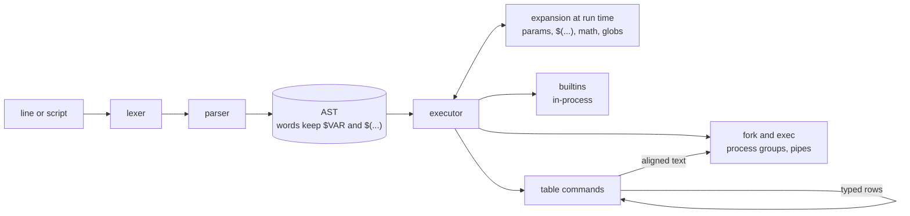

<div align="center">

<picture>
  <source media="(prefers-color-scheme: dark)" srcset=".github/assets/logo-dark.svg">
  
</picture>

### A small Unix shell written in Rust.<br>Bash style scripting, job control, pipelines that carry typed tables, and an agent mode.

<p>
  <a href="https://github.com/gdprojectsss/goRustlyFast/actions/workflows/ci.yml"></a>
  <a href="https://www.rust-lang.org"></a>
  <a href="Cargo.toml"></a>
  <a href="LICENSE"></a>
  <a href="https://github.com/gdprojectsss/goRustlyFast/stargazers"></a>
  <a href="https://github.com/gdprojectsss/goRustlyFast/releases"></a>
  <a href="https://grf.sh/docs/"></a>
</p>

<p>
  <a href="#quick-start"><b>Quick start</b></a> |
  <a href="https://grf.sh/docs/"><b>Docs</b></a> |
  <a href="#table-pipelines"><b>Table pipelines</b></a> |
  <a href="#for-coding-agents"><b>For agents</b></a> |
  <a href="#why-grfsh"><b>Why grfsh</b></a> |
  <a href="#performance"><b>Performance</b></a> |
  <a href="#how-it-works"><b>How it works</b></a> |
  <a href="#roadmap"><b>Roadmap</b></a> |
  <a href="README.ro.md"><b>Romana</b></a> |
  <a href="README.zh-CN.md"><b>简体中文</b></a>
</p>


</div>

<br>

> [!NOTE]
> grfsh runs real scripts and makes a pleasant interactive shell, but it does not cover all of bash yet: it passes about 82% of the Oils bash spec suite, where bash itself passes 89%. Run `grfsh --check script.sh` to see whether a script uses anything grfsh cannot run, and see [compatibility](https://grf.sh/docs/compatibility/) for the full list.

## What is grfsh?

grfsh is a shell with bash compatible syntax for the common cases: pipes, redirections, `if`/`for`/`while`, functions, `$(...)`, `${x:-default}`, `$((math))`, heredocs and job control.

For interactive use it has autosuggestions from history, syntax highlighting, completion for git branches, ssh hosts and make targets, suggestions for mistyped commands, a `z` command for directories you visit often, and a prompt that shows the exit status and duration of the last command.

It also has a set of table commands. `files`, `procs` and `load` produce typed tables, so `where size -gt 10mb` compares sizes and `where modified gt 2d` compares dates. When a table is piped into `grep` or `wc`, it is printed as plain text.

For coding agents and CI jobs it has an agent mode: no pagers or prompts, output that stays within a budget, JSON results, a persistent session server, `timeout`, `explain` and exact file edits.

It has two direct dependencies: `rustyline` for line editing and `libc` for processes and signals.

## Quick start

```sh
curl -fsSL https://grf.sh | sh
```

The script picks the release binary for your system, checks its SHA-256 sum and installs to `~/.local/bin`. Other ways to install:

| System | Command |
| --- | --- |
| Homebrew | `brew install gdprojectsss/tap/grfsh` |
| Debian, Ubuntu | `sudo apt install ./grfsh_<version>_amd64.deb` with the file from the [latest release](https://github.com/gdprojectsss/goRustlyFast/releases/latest) |
| Fedora, RHEL | `sudo dnf install ./grfsh-<version>.x86_64.rpm` with the file from the latest release |
| Arch Linux | `makepkg -si` in [`packaging/aur/grfsh-bin`](packaging/aur/grfsh-bin) or [`grfsh-git`](packaging/aur/grfsh-git), AUR packages coming |
| Nix | `nix run github:gdprojectsss/goRustlyFast` |
| Cargo | `cargo install grfsh` |

Release files come with a cosign signed `SHA256SUMS`, see [installation](https://grf.sh/docs/installation/).

```
grfsh                          interactive shell
grfsh -l                       login shell, reads ~/.grfsh_profile first
grfsh script.sh [args...]      run a script
grfsh -c 'command' [name args] run one command line
grfsh --check script.sh        list what grfsh cannot run, without running it
grfsh --agent -c 'command'     agent mode, see below
```

To make it your login shell, add its path to `/etc/shells` and run `chsh -s "$(command -v grfsh)"`. The [login shell guide](https://grf.sh/docs/login-shell/) covers terminal apps too.

A few things to try once it is running:

```sh
for f in src/*/mod.rs; do echo "$f: $(wc -l < $f) lines"; done
greet() { local who=${1:-world}; echo "hi $who"; }; greet
sleep 30 &                     # then: jobs, fg, Ctrl-Z, bg
gti status                     # did you mean 'git'?
z proj                         # jump to a directory you visit often
git checkout <TAB>             # branches
```

## Table pipelines

Table commands hand each other typed rows. On a terminal the result is an aligned table, anywhere else it is plain text that `grep`, `awk` and friends understand.

```console
$ load servers.csv | where cpu -gt 50 | sort-by cpu -r
host   region  cpu  uptime_days
-----  ------  ---  -----------
db-1   us       91          203
web-1  eu       72           41

$ load servers.csv | where region == eu | to json
[{"host":"web-1","region":"eu","cpu":72,"uptime_days":41},{"host":"web-2","region":"eu","cpu":18,"uptime_days":41}]

$ ps aux | where %CPU gt 5 | select PID %CPU COMMAND
$ files src -r | where name =~ '\.rs$' | math sum size
$ load servers.csv | group-by region
```

| Command | What it does |
| --- | --- |
| `files [path] [-a] [-r]` | directory listing with name, type, size, modified, `-r` for recursive |
| `procs` | running processes with pid, ppid, cpu, mem, rss, name |
| `load <file>` | reads `.csv`, `.tsv`, `.json`, `.jsonl`, anything else as lines |
| `from csv\|tsv\|json\|jsonl\|ws\|lines` | parses text coming from a pipe |
| `where <column> <op> <value> [and\|or ...]` | keeps matching rows, ops: `== != =~ !~ has lacks eq ne lt le gt ge` |
| `sort-by <column>... [-r]` | sorts by one or more columns |
| `select` / `reject <column>...` | keeps or drops columns |
| `first [n]`, `skip [n]`, `reverse` | slices rows |
| `count`, `get [-0] <column>` | prints the row count or one column as plain lines, NUL separated with `-0` |
| `group-by <column>` | counts rows per value |
| `uniq-by <column>` | keeps the first row for each value |
| `math sum\|avg\|min\|max\|median <column>` | aggregates a column, keeping sizes as sizes |
| `update <column> <value>` | sets or adds a column |
| `to csv\|tsv\|json\|md\|html\|table` | converts the table to text |

<details>
<summary><b>Details: values, operators and text input</b></summary>

<br>

- Values follow the column type: `10mb` or `1.5 GB` for sizes, `2d`, `3h` or `2026-01-31` for dates, plain numbers for numbers. A value that does not fit the column is an error. An age means that long ago, so `where modified gt 2d` keeps files changed in the last two days.
- `=~` and `!~` take an extended regular expression, case sensitive unless it starts with `(?i)`, and `\d \w \s \b` work everywhere. `has` and `lacks` match a substring, ignoring case. `and` and `or` join conditions only when a column and an operator follow, so `where 'name == rock and roll'` compares with the whole text.
- Tables shown on a terminal or written as text, markdown or html show control characters as `\e`, `\n`, `\x07` and so on. `get` prints values exactly, and `get -0` separates them with NUL bytes for `xargs -0`.
- `<` and `>` are redirections in every shell, so write `where size -gt 1mb` or quote the condition: `where 'size > 1mb'`.
- Output from regular commands is parsed as JSON when it looks like JSON, otherwise as whitespace separated columns with a header line, which is what `ps`, `df` and `docker ps` print.
- To run a system command that shares a name with a table command, use `command`, for example `command procs`.

</details>

## For coding agents

Agents, CI jobs and editor integrations drive a shell with nobody at the keyboard. grfsh has the pieces they need built in:

```console
$ grfsh --json -c 'cd /tmp; export MODE=test; echo built'
{"status":0,"stdout":"built\n","stderr":"","duration_ms":0,"cwd":"/tmp","env":{"MODE":"test"},"truncated":false,"stdout_log":null,"stderr_log":null}

$ build=; explain 'rm -rf $build/'
   1  rm -rf /
        warning: $build is empty or unset here
        deletes recursively: /
        warning: this deletes /
        runs /bin/rm

$ search -l old_name src | replace old_name new_name
src/main.rs: 2 replacements
```

| Tool | What it does |
| --- | --- |
| `--agent` or `GRFSH_AGENT=1` | pagers become `cat`, colors and git prompts are off, and commands that try to read from the terminal fail at once |
| output budget | long output keeps its first and last lines, the rest is saved to a file whose path is printed |
| `--json` | status, stdout, stderr, duration, final directory and changed environment as one object |
| `--serve socket`, `--client` | a shell that keeps its directory, variables and functions between requests, with per request timeouts; requests run one at a time with standard input from `/dev/null` |
| `timeout` | stops the whole process group, works on macOS and with functions |
| `explain`, `--explain` | shows each command after expansion without running it, and flags risky ones |
| `replace`, `write-file` | exact, atomic edits that fail when the text is missing or appears twice; `write-file` refuses empty input unless given `-f` |
| `search`, `git-status`, `ports` | `.gitignore` aware search and status as tables |

The [agent guide](https://grf.sh/docs/agents/) has the details, and [grf.sh/llms.txt](https://grf.sh/llms.txt) has the same instructions in a compact form for agents to read.

## Why grfsh?

How grfsh compares to other shells on the features it focuses on:

|                                              | **grfsh** | bash | zsh | fish | nushell |
| -------------------------------------------- | :-------: | :--: | :-: | :--: | :-----: |
| POSIX style syntax (`if`, `for`, `$(...)`)   |    yes    | yes  | yes |  no  |   no    |
| Plain text pipes work unchanged              |    yes    | yes  | yes | yes  |   yes   |
| Typed table pipelines                        |    yes    |  no  | no  |  no  |   yes   |
| Autosuggestions out of the box               |    yes    |  no  | no  | yes  |   yes   |
| Syntax highlighting out of the box           |    yes    |  no  | no  | yes  |   yes   |
| Frecent directory jumping built in           |    yes    |  no  | no  |  no  |   no    |
| Agent mode with JSON results                 |    yes    |  no  | no  |  no  |   no    |
| Mature and battle tested                     |    no     | yes  | yes | yes  | partial |

<sub>Compared with default installs, no plugins or extra configuration, as of October 2026. Corrections are welcome in an issue.</sub>

## Performance

grfsh is measured against dash, bash and zsh with [hyperfine](https://github.com/sharkdp/hyperfine). Run `scripts/bench.sh` to reproduce. Mean wall time on an Apple M2 with macOS 26.6, using the system bash 3.2.57, dash and zsh 5.9:

| Benchmark | grfsh | dash | bash | zsh |
| --- | ---: | ---: | ---: | ---: |
| Startup, `-c true` | 2.0 ms | 1.2 ms | 1.6 ms | 2.6 ms |
| 20,000 iteration `while [ ]` loop | 31.6 ms | 37.0 ms | 65.9 ms | 35.1 ms |
| Building a string 5,000 times | 16.6 ms | 50.2 ms | 917.0 ms | 107.8 ms |
| Five stage pipeline | 4.6 ms | 3.7 ms | 4.2 ms | 5.5 ms |
| 200 command substitutions | 87.0 ms | 77.1 ms | 83.9 ms | 91.7 ms |

`test` and `[` are builtins, so conditions inside loops do not fork. CI fails when a loop, string or substitution benchmark takes more than twice as long as dash on its Linux runner, where the loop currently measures 1.7 times dash. The bash shipped with macOS is old; a current bash will do better on the string benchmark.

## How it works



- The parser keeps `$VAR`, `$(...)` and globs unexpanded in the syntax tree. They are expanded right before a command runs, so `false && echo $(rm -rf x)` does not run `rm`.
- Pipeline stages, subshells and `$(...)` run as forked children in their own process groups. The shell hands the terminal to the foreground group, so Ctrl-Z, `fg`, `bg` and Ctrl-C work.
- Two table commands next to each other exchange rows in a small typed format. Any other command receives plain text.
- Redirections are applied to file descriptors, so `2>&1`, `&>`, `>&-` and heredocs also work for builtins and functions.

## Features

<table>
<tr>
<td width="50%" valign="top">

**Scripting**
- `if`, `while`, `for`, `case`, `[[ ]]`, functions, `getopts`, `trap`
- `${x#pat}`, `${x/a/b}`, `${x^^}`, `${x:1:3}`, `$((math))`, `{1..10}`
- Indexed and associative arrays, `declare`, `readonly`, `mapfile`
- `<(cmd)`, `exec 3>file`, `set -euo pipefail`, `$PIPESTATUS`, `time`

</td>
<td width="50%" valign="top">

**Interactive**
- Themes with segments, right and transient prompts, `configure-prompt`
- Autosuggestions, highlighting, vi mode, `abbr`, `bindkey`
- Completion for git, cargo, ssh, make and your own `complete` rules
- `z`, "did you mean", `!!` expansion, `history --table`

</td>
</tr>
<tr>
<td valign="top">

**Agents**
- `--agent`, `--json`, an output budget and job logs
- `--serve` sessions with per request timeouts
- `timeout`, `explain`, `replace`, `write-file`
- `search`, `git-status` and `ports` as tables

</td>
<td valign="top">

**Distribution**
- Static musl Linux binary, macOS builds for Intel and Apple silicon
- `.deb`, `.rpm`, AUR, Nix, Homebrew and an install script
- Cosign signed checksums, a man page and docs at grf.sh
- Fuzzed parser and a compatibility suite against bash 5.3

</td>
</tr>
<tr>
<td valign="top">

**Jobs and processes**
- `cmd &`, `jobs`, `fg`, `bg`, `wait`, `kill %1`
- Ctrl-Z stops the foreground job, Ctrl-C stops loops too
- Redirections on any fd: `2>`, `2>&1`, `&>`, `>&-`
- Prompt shows git branch with a dirty marker, exit status, duration

</td>
<td valign="top">

**Data**
- `files`, `procs`, `load`, `from` produce typed tables
- `where`, `sort-by`, `select`, `group-by`, `uniq-by`, `math`
- Sizes and dates compare as sizes and dates
- `to csv`, `to json`, `to md`, or plain text for other tools

</td>
</tr>
</table>

## Configuration

`~/.grfshrc`, or `~/.config/grfsh/grfshrc`, runs on startup. Login shells read `~/.grfsh_profile` first.

```sh
export EDITOR=nvim
alias ll='ls -la'
alias gs='git status'

mkcd() { mkdir -p "$1" && cd "$1"; }
```

### Prompt themes

Run `configure-prompt` for a short wizard with live previews, or pick a preset with `configure-prompt --preset rainbow`. Presets: `lean`, `classic`, `rainbow`, `pure` and `minimal`. The result is a plain file in `~/.config/grfsh/theme` that you can edit; changes show at the next prompt.

```ini
style = lean            # lean, classic or rainbow
icons = nerd            # nerd, unicode or ascii
lines = 1
transient = true
left = context dir git
right = status duration jobs venv rust node python go time
color.dir = #61afef
```

Segments only appear when they have something to say: `status` after a failure, `duration` for slow commands, `rust` inside a cargo project. Set `engine = starship` to draw the prompt with [starship](https://starship.rs) instead.

### Hooks, keys and completion

```sh
precmd() { printf '\033]0;%s\007' "${PWD##*/}"; }   # runs before each prompt
chpwd() { ls; }                                      # runs after the directory changes
abbr gco 'git checkout'                              # expands when the line is submitted
bindkey '^G' clear-screen                            # bindkey -l lists actions
complete -W 'start stop restart status' svc          # also -C 'command', -d, -f
set -o vi
```

Plugins are directories in `~/.config/grfsh/plugins/` with an `init.grfsh` file, loaded in order at startup.

### Classic prompt variable

Without a theme file, `GRFSH_PROMPT` customizes the default prompt. Placeholders: `{user}`, `{host}`, `{cwd}`, `{branch}`, `{dirty}`, `{git}`, `{status}`, `{duration}`, `{jobs}` and the colors `{green}`, `{blue}`, `{magenta}`, `{cyan}`, `{red}`, `{yellow}`, `{bold}`, `{reset}`.

```sh
export GRFSH_PROMPT='{blue}{cwd}{reset} {git}{red}{status}{reset}> '
```

<details>
<summary><b>Builtins</b></summary>

<br>

`cd`, `z`, `pushd`, `popd`, `dirs`, `pwd`, `printf`, `test`, `[`, `trap`, `timeout`, `replace`, `write-file`, `explain`, `history`, `declare`, `typeset`, `readonly`, `getopts`, `shopt`, `mapfile`, `readarray`, `exec`, `umask`, `ulimit`, `abbr`, `bindkey`, `complete`, `configure-prompt`, `echo`, `exit`, `export`, `unset`, `local`, `set`, `shift`, `read`, `source`, `.`, `eval`, `alias`, `unalias`, `type`, `command`, `return`, `break`, `continue`, `jobs`, `fg`, `bg`, `wait`, `kill`, `true`, `false`, `:`

</details>

<details>
<summary><b>Project layout</b></summary>

<br>

```
src/
  syntax/    lexer, parser and AST
  expand/    word expansion, arithmetic, globbing
  exec/      running commands, pipelines, redirections, processes
  builtins/  builtin commands
  table/     typed values, table commands, JSON and CSV, rendering
  repl/      prompt themes, completion, highlighting, keys, the interactive loop
  agent/     agent mode, output budget, explain, the session server
  check.rs   static checks behind grfsh --check
```

</details>

## Roadmap

| Phase | Scope | Status |
| ----- | ----- | :----: |
| 1 | Commands, pipes, redirections, colors, history | done |
| 2 | Globs, command substitution, syntax highlighting, tests, CI | done |
| 3 | AST parser, run time expansion, scripting, job control | done |
| 3 | `z`, context aware completion, "did you mean", richer prompt | done |
| 3 | Typed table pipelines, JSON and CSV | done |
| 4 | `case`, `[[ ]]`, arrays, parameter operators, brace expansion | done |
| 4 | `trap`, `set -euo pipefail`, `printf`, `pushd`, history expansion | done |
| 4 | Async git prompt, benchmarks, loop and string speedups, fuzz style tests | done |
| 4 | `group-by`, `uniq-by`, `math`, `update`, login shell, release packaging | done |
| 5 | `getopts`, `declare`, associative arrays, `$PIPESTATUS`, `**` globs, process substitution | done |
| 5 | Native themes, right and transient prompts, `configure-prompt`, hooks, vi mode | done |
| 5 | `grfsh --check` for scripts, queryable history table, plugins, `abbr`, `bindkey` | done |
| 6 | Conformance and differential tests, fuzzing, hardening | done |
| 6 | Releases, packages, man page, docs site, migration guides | done |
| 6 | Agent mode, JSON results, sessions, `timeout`, `explain`, `replace`, `search` | done |

## Star history

<a href="https://star-history.com/#gdprojectsss/goRustlyFast&Date">
  <picture>
    <source media="(prefers-color-scheme: dark)" srcset="https://api.star-history.com/svg?repos=gdprojectsss/goRustlyFast&type=Date&theme=dark">
    
  </picture>
</a>

## Contributing

Issues and pull requests are welcome, see [CONTRIBUTING.md](CONTRIBUTING.md). Before sending a change, run the same checks as CI:

```sh
cargo fmt --check
cargo clippy --all-targets -- -D warnings
cargo test
```

<a href="https://github.com/gdprojectsss/goRustlyFast/graphs/contributors">
  
</a>

## License

[MIT](LICENSE)
