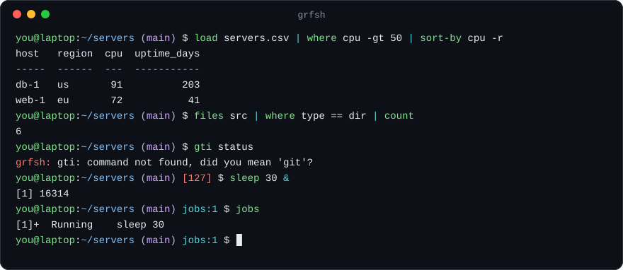

<div align="center">

<picture>
  <source media="(prefers-color-scheme: dark)" srcset=".github/assets/logo-dark.svg">
  
</picture>

### 一个用 Rust 编写的小巧 Unix shell。<br>bash 风格的脚本、作业控制、传递带类型表格的管道，以及面向编程代理的模式。

<p>
  <a href="https://github.com/gdprojectsss/goRustlyFast/actions/workflows/ci.yml"></a>
  <a href="https://www.rust-lang.org"></a>
  <a href="LICENSE"></a>
  <a href="https://github.com/gdprojectsss/goRustlyFast/releases"></a>
  <a href="https://grf.sh/zh-cn/docs/"></a>
</p>

<p>
  <a href="#快速开始"><b>快速开始</b></a> |
  <a href="https://grf.sh/zh-cn/docs/"><b>文档</b></a> |
  <a href="#表格管道"><b>表格管道</b></a> |
  <a href="#面向编程代理"><b>面向代理</b></a> |
  <a href="#性能"><b>性能</b></a> |
  <a href="README.md"><b>English</b></a> |
  <a href="README.ro.md"><b>Romana</b></a>
</p>



</div>

<br>

> [!NOTE]
> grfsh 1.0 能运行真实的脚本，交互使用也很顺手，但并未覆盖 bash 的全部功能：扩展 glob、名称引用（`declare -n`）、协程（`coproc`）和 `select` 尚不支持。运行 `grfsh --check script.sh` 可以查看脚本是否用到了 grfsh 无法运行的内容，完整列表见[兼容性](https://grf.sh/zh-cn/docs/compatibility/)。

## grfsh 是什么？

grfsh 在常见场景下使用与 bash 兼容的语法：管道、重定向、`if`/`for`/`while`、函数、`$(...)`、`${x:-默认值}`、`$((算术))`、here document 和作业控制。

交互使用时，它提供基于历史记录的自动建议、语法高亮、git 分支、ssh 主机和 make 目标的补全、输错命令时的提示、用于常用目录的 `z` 命令，以及可以显示上一条命令退出状态和耗时的主题化提示符。

它还带有一组表格命令。`files`、`procs`、`search` 和 `load` 输出带类型的表格，所以 `where size -gt 10mb` 按文件大小比较，`where modified gt 2d` 按日期比较。表格交给 `grep` 或 `wc` 时，会以纯文本形式输出。

对于编程代理和 CI 任务，它提供代理模式：不打开分页器、不等待输入、控制输出长度、以 JSON 返回结果，还有持久会话服务器、`timeout`、`explain` 和精确的文件编辑。

它只依赖两个 crate：用于行编辑的 `rustyline` 和用于进程与信号的 `libc`。

## 快速开始

```sh
curl -fsSL https://grf.sh | sh
```

脚本会为你的系统选择合适的二进制文件，校验 SHA-256 校验和，并安装到 `~/.local/bin`。另外还提供 `.deb` 和 `.rpm` 软件包、AUR 的 PKGBUILD、Nix flake、`brew install gdprojectsss/tap/grfsh` 以及 `cargo install grfsh`。详见[安装](https://grf.sh/zh-cn/docs/installation/)。

```
grfsh                          交互式 shell
grfsh -l                       登录 shell，先读取 ~/.grfsh_profile
grfsh script.sh [参数...]      运行脚本
grfsh -c '命令' [名称 参数]    运行一行命令
grfsh --check script.sh        列出 grfsh 无法运行的内容，不执行脚本
grfsh --agent -c '命令'        代理模式，见下文
```

要设为登录 shell，把它的路径加入 `/etc/shells`，然后运行 `chsh -s "$(command -v grfsh)"`。

## 表格管道

表格命令之间传递带类型的行。在终端中显示为对齐的表格，在其他地方则是 `grep`、`awk` 等工具能理解的纯文本。

```console
$ load servers.csv | where cpu -gt 50 | sort-by cpu -r
host   region  cpu  uptime_days
-----  ------  ---  -----------
db-1   us       91          203
web-1  eu       72           41

$ search -l old_name src | replace old_name new_name
src/main.rs: 2 replacements
```

| 命令 | 作用 |
| --- | --- |
| `files [路径] [-a] [-r]` | 列出目录，包含 name、type、size、modified 列，`-r` 递归 |
| `procs` | 正在运行的进程 |
| `search [-i] [-F] [-l] 模式 [路径...]` | 遵循 `.gitignore` 的内容搜索 |
| `git-status`、`ports` | 变更的文件，以及正在监听的端口 |
| `load <文件>` | 读取 `.csv`、`.tsv`、`.json`、`.jsonl`，其他文件按行读取 |
| `where <列> <运算符> <值>` | 保留匹配的行 |
| `sort-by`、`select`、`reject`、`first`、`count`、`get` | 排序、选取和切片 |
| `group-by`、`uniq-by`、`math`、`update` | 分组、去重、聚合和修改列 |
| `to csv\|tsv\|json\|md\|html` | 把表格转换为文本 |

## 面向编程代理

| 工具 | 作用 |
| --- | --- |
| `--agent` 或 `GRFSH_AGENT=1` | 分页器变为 `cat`，关闭颜色和 git 提示，尝试从终端读取输入的命令会立即失败 |
| 输出预算 | 过长的输出只保留开头和结尾，其余部分保存到文件并打印路径 |
| `--json` | 把状态、stdout、stderr、耗时、最终目录和变化的环境变量放进一个对象 |
| `--serve 套接字`、`--client` | 在请求之间保留目录、变量和函数的 shell，支持按请求设置超时 |
| `timeout` | 停止整个进程组，在 macOS 上和函数中同样可用 |
| `explain`、`--explain` | 不执行命令，显示展开后的每条命令并标出有风险的操作 |
| `replace`、`write-file` | 精确的原子编辑，文本缺失或重复出现时会失败 |

详见[代理指南](https://grf.sh/zh-cn/docs/agents/)。代理也可以直接读取 [grf.sh/llms.txt](https://grf.sh/llms.txt)。

## 性能

使用 [hyperfine](https://github.com/sharkdp/hyperfine) 与 dash、bash 和 zsh 对比，可用 `scripts/bench.sh` 复现。测试环境为 Apple M2、macOS 26.6、系统自带的 bash 3.2.57、dash 和 zsh 5.9，数值为平均耗时：

| 测试 | grfsh | dash | bash | zsh |
| --- | ---: | ---: | ---: | ---: |
| 启动，`-c true` | 2.0 ms | 1.2 ms | 1.6 ms | 2.6 ms |
| 20,000 次 `while [ ]` 循环 | 31.6 ms | 37.0 ms | 65.9 ms | 35.1 ms |
| 拼接字符串 5,000 次 | 16.6 ms | 50.2 ms | 917.0 ms | 107.8 ms |
| 五段管道 | 4.6 ms | 3.7 ms | 4.2 ms | 5.5 ms |
| 200 次命令替换 | 87.0 ms | 77.1 ms | 83.9 ms | 91.7 ms |

## 配置

启动时会运行 `~/.grfshrc` 或 `~/.config/grfsh/grfshrc`，登录 shell 会先读取 `~/.grfsh_profile`。运行 `configure-prompt` 可以通过带实时预览的向导选择提示符主题，预设有 `lean`、`classic`、`rainbow`、`pure` 和 `minimal`。另外还支持钩子（`precmd`、`preexec`、`chpwd`）、`abbr`、`bindkey`、`complete`、`set -o vi`，以及放在 `~/.config/grfsh/plugins/` 中的插件。

## 参与贡献

欢迎提交 issue 和 pull request，请先阅读 [CONTRIBUTING.md](CONTRIBUTING.md)。提交改动前，请运行与 CI 相同的检查：

```sh
cargo fmt --check
cargo clippy --all-targets -- -D warnings
cargo test
```

## 许可证

[MIT](LICENSE)
